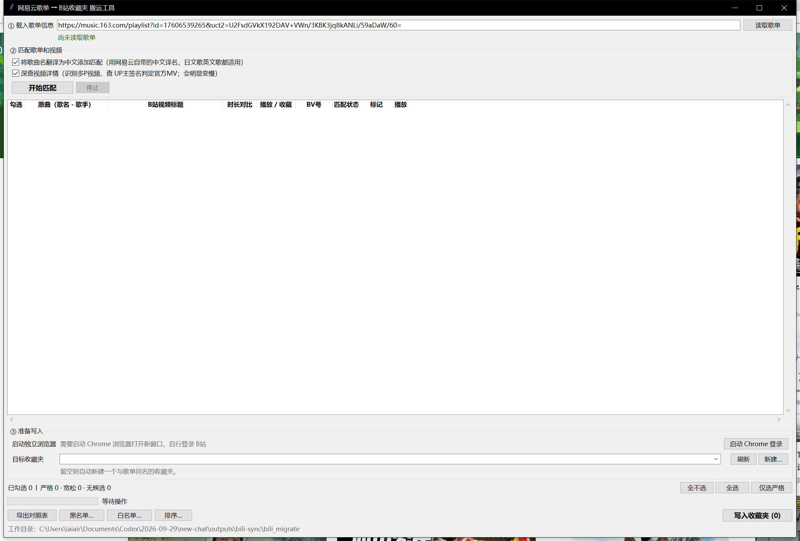

# 网易云音乐歌单 → B站收藏夹 迁移工具



把网易云歌单里的歌，逐首在 B站 找到对应的视频，收藏进一个收藏夹。

---

## 免责声明

> **使用前请完整阅读。下载、运行或使用本工具，即视为你已知悉并同意以下全部内容。**

1. **仅限个人学习与技术交流。** 本工具用于把自己的网易云歌单迁移到自己的 B站 收藏夹，
   免费提供，**不含任何盈利目的**——不收费、无广告、无赞助、无付费功能，
   也不接受商业定制。

2. **与平台方无关。** 本工具**不是**网易云音乐或哔哩哔哩的官方产品，
   未获得两家公司的授权、认可或支持，与它们不存在任何隶属或合作关系。

3. **用途限定。** 仅可用于迁移**你本人有权访问的歌单**。禁止用于批量养号、刷数据、
   爬取平台内容、商业转售、绕过平台限制，或任何违反平台用户协议及当地法律法规的用途。

4. **使用风险自负。** 本工具通过平台接口完成操作，**可能触发平台的风控机制**
   （操作被拦截、功能被临时限制等）。请先看[安全性与风险](#安全性与风险)一节，
   自行评估后再决定是否使用。

5. **不涉及音视频内容。** 本工具只做「搜索 + 收藏」，**不下载、不转存、不上传、
   不传播**任何音视频内容。收藏夹里所有内容的版权归原作者及相应权利人所有。

6. **凭据与数据自行保管。** 登录凭据保存在你自己的电脑上，
   请勿分享包含 `bili_profile` 目录或 `gui_config.json` 的文件夹。

7. **按现状提供，不作担保。** 不保证匹配结果准确、不保证功能持续可用
   （平台接口随时可能变更）、不保证运行过程不出错。

8. **责任限制。** 因使用或无法使用本工具而产生的任何直接或间接损失
   （包括但不限于账号受限、数据丢失、收藏内容不符预期），作者不承担任何责任。
   **请在写入收藏夹前自行核对匹配结果。**

9. **权利主张。** 如权利人认为本工具存在侵权，请联系作者，会及时处理。

> 一句话：**免费、非官方、不碰内容、风险自负。**

---

- **双击 `bili_sync.exe` 就能运行**，不需要安装 Python，不需要任何额外步骤
- 只做「搜索 + 收藏」：不下载视频、不转存、不上传
- 全程**只在你点「写入收藏夹」的那一刻**才会动你的 B站 账号

> **文中的「见某节」是这样写的：`见[单条修正](#单条修正)`**——这是**文章内跳转**，
> 需要支持 markdown 的阅读器才能点
> （VS Code 按 `Ctrl+Shift+V` 开预览、Typora、GitHub 网页版都行）。
> 用记事本打开会看到原始符号，那不是文档坏了，换个阅读器即可。
> 跳不动也不影响阅读——链接文字就是章节名。
>
> 首次运行 exe 如果报 `Failed to load Python DLL ... _MEI...`，
> 是杀毒软件在扫描新生成的 exe，等几秒再运行一次即可。

---

## 下载

| 方式 | 说明 |
| --- | --- |
| **下载打包好的 exe**（推荐） | 在仓库页面右侧的 **Releases** 里下载 `bili_sync.exe`，双击就能用，**不需要安装 Python** |
| 用源码运行 | 下载三个 `.py` 文件，装好 Python 3.8+ 后运行 `python bili_app.py`。只用标准库，不用装任何第三方包 |

> exe 为什么放在 Releases 而不是仓库里？二进制文件每更新一次版本，git 都会把旧版本
> 永久保留在历史里，仓库会越滚越大。放 Releases 既能下载，又不拖累仓库。

---

## 快速开始

双击 `bili_sync.exe`，然后照着界面上 **①②③** 的编号走：

1. 粘贴网易云歌单链接 → 点「读取歌单」
2. 点「开始匹配」，等列表填满 → 逐条核对、勾选要导入的
3. 点「启动 Chrome 登录」→ 在弹出的窗口里**扫码登录 B站** → 回程序选收藏夹
4. 点右下角「写入收藏夹」

### 怎么拿到歌单链接

1. 打开网易云音乐 App，进入你要迁移的那个**歌单**
2. 点歌单页面右上角的「**分享**」
3. 选「**复制链接**」
4. 把复制到的内容**原样粘贴**到程序的 ① 输入框里，点「读取歌单」

网页版也一样：打开歌单页面，直接复制浏览器地址栏里的链接即可。

> 链接长什么样都行——带 `uct2` 参数的长链、`#/playlist?id=` 形式的、
> 甚至微信里分享出来的一整段文案，程序都能自动识别出歌单 ID。

## 详细步骤

| 步骤 | 界面位置 | 操作 | 说明 |
| --- | --- | --- | --- |
| **1** | — | 复制网易云歌单的分享链接 | 手机 App「分享 → 复制链接」，或网页版地址栏的链接都行 |
| **2** | **① 载入歌单信息** | 粘贴链接，点「读取歌单」 | 支持长链、短链、带 `uct2` 参数的链接、微信分享文案 |
| **3** | **② 匹配歌单和视频** | 按需调整两个勾选项，点「开始匹配」 | 逐首搜索并填入 B站 视频，可随时点「停止」 |
| **4** | 中间的匹配列表 | 逐条核对，勾选要导入的 | 不满意的双击或右键修正，见[单条修正](#单条修正) |
| **5** | **③ 准备写入** | 点「启动 Chrome 登录」 | 打开一个独立配置的 Chrome 窗口，不影响你日常用的浏览器 |
| **6** | 弹出的 Chrome 窗口 | **扫码登录 B站**，然后回程序点「刷新」 | 登录后**保持窗口开着**。同一台电脑上以后一般不用重复登录 |
| **7** | 右下角 | 点「写入收藏夹」 | 按列表**从上到下**的顺序写入，已经在夹里的自动跳过 |

> 为什么 ① 之后直接是「匹配」而不是「登录」？因为**匹配阶段完全不需要登录**。
> 先把视频列表跑出来核对好，最后再登录写入，能少开一会儿浏览器、也少一次登录动作。

> 点「开始匹配」时会弹一个提示，告诉你不放心让程序写入的话，可以自己复制 BV 号
> 或打开视频手动收藏。勾上「以后不再提示」就不再弹。

---

## 界面说明

### 两个勾选项

| 勾选项 | 默认 | 作用 |
| --- | --- | --- |
| **将歌曲名翻译为中文添加匹配** | 开 | 用网易云自带的中文译名多搜一次，语种不限，见[歌曲名的中文译名](#歌曲名的中文译名) |
| **深查视频详情** | 开 | 识别多P视频、查 UP主签名判定官方MV。关掉更快，但这两项判定会退化 |

### 列表的颜色和勾选规则

| 状态 | 颜色 | 默认勾选 | 含义 |
| --- | --- | --- | --- |
| **严格** | 无 | ✅ | 时长在原曲 ±3 秒内 |
| **宽松** | 浅黄 | ⬜ | 时长在原曲 80%~120%，但不在严格区间，建议你确认 |
| **无候选** | 灰字 | ⬜ | 没有通过过滤的候选 |
| **手动指定** | 浅蓝 | ✅ | 你自己挑的候选或填的 BV 号 |
| **本轮已写入** | 浅绿 | — | 本轮刚写入成功 |
| **已收藏跳过** | 灰字 | — | 收藏夹里本来就有，本轮跳过 |
| **写入失败** | 浅红 | — | 写入报错，原因看「标记」栏和状态栏 |

底部三个按钮控制批量勾选：**仅选严格**（只勾自动匹配可靠的）、
**全选**（勾上所有有 BV 号的，**会把可疑项也一起选上，慎用**）、**全不选**。

### 单条修正

| 操作 | 效果 |
| --- | --- |
| **点第一列** | 切换勾选 |
| **点最右边的「▶」** | 在登录用的那个浏览器窗口里打开视频，直接看一遍确认选得对不对 |
| **右键 →「复制 BV 号」** | 把 BV 号复制到剪贴板，方便你去 B站 自己搜 |
| **右键 →「换一个候选视频…」** | 打开候选列表挑一个 |
| **右键 →「重新搜索」** | 换关键词重搜（比如换成中文译名） |
| **右键 →「手动填写 BV 号…」** | 直接指定 BV 号，回车后自动查标题和时长 |
| **双击「BV号」列** | 同上，行内直接改 |
| **选中某行按 `Ctrl+C`** | 复制该行 BV 号 |

**候选列表的规则**：默认列出通过歌名和时长过滤的候选，按当前排序规则排好序，
每行标注 `官方MV` / `白名单` / `多P` / `合唱?` / `译名` 等标记。
如果过滤后一条都不剩，会自动改列**搜索的原始结果**并给出警告——
那些可能有完全不相干的视频，点「使用这条」仍会被采纳，需要你自己确认。

手动改 BV 号时会校验格式（`BV` + 10 位），失效视频会提示"不存在或已被删除"，
多P视频会提醒你收藏的是整个稿件。

### 列宽

表头可以直接拖动调整，**每一列都能单独改**，拖宽了会自动出现横向滚动条。
调整后的列宽会记住，下次打开保持原样。

### 目标收藏夹

下拉框里列出你账号下所有收藏夹，带内容数量和可见性。三种用法：

- **选中已有的夹**：写入这个夹
- **选「自动新建（与歌单同名）」**：写入时自动创建，并询问你设为公开还是私密
- **点「新建…」**：指定名字和可见性，立刻创建

> 同一个歌单请始终选同一个夹。好在重复导入是安全的——已经在夹里的会被自动跳过，
> 见[写入收藏夹](#写入收藏夹)。

---

## 匹配规则

规则分三层，**顺序很重要**：前两层是淘汰条件，第三层是排序条件。

### 程序用什么关键词搜

每首歌会搜**多次**再合并去重，不是只搜一次：

| 关键词 | 说明 |
| --- | --- |
| `歌名 + 第一位歌手` | 主搜索 |
| `歌名` | 只用歌名 |
| `译名 + 第一位歌手` | 如果网易云给了中文译名 |

**为什么要搜多次**：实测把歌手名拼进关键词后，B站 反而会把好视频挤出前 20 名，
英文歌手名尤其明显——对方的标题里往往只有歌名（可能是中文译名），没有歌手名。

代价是搜索请求翻倍，匹配总时长会增加（见[深查开关与耗时](#深查开关与耗时)）。

### 第 0 层：硬过滤

不通过的直接淘汰，不参与排序：

| # | 条件 |
| --- | --- |
| 1 | **黑名单**：标题命中任一词（翻唱、钢琴、现场、歌单…）→ 淘汰 |
| 2 | **标题必须含歌名**：含**原名**或**官方中文译名**任一个，都没有 → 淘汰 |
| 3 | **短歌名保护**：歌名去掉标点后 ≤2 字时（如「光」），标题还必须出现歌手名 |

第 2 条是最关键的一条。实测只靠"时长 + 黑名单 + 播放量"会把完全无关的歌配进来。

### 第 1 层：时长分级

以**网易云歌单里的时长**为基准：

| 状态 | 判定 | 默认勾选 |
| --- | --- | --- |
| **严格** | 原曲 **±3 秒**以内 | ✅ |
| **宽松** | 视频时长在原曲的 **80% ~ 120%** 之间 | ⬜ 留你确认 |
| **不符合** | 其余 | ⬜ 不能自动选中（候选框里仍可手动挑） |

3 秒余量是因为网易云的时长含音频编码填充，通常比实际音频多算 1~2 秒。

> 这一层是**安全阀**：无论排序怎么调、身份是不是官方，不符合的都不会被自动选中。

### 多P视频怎么算时长

B站 有些歌曲视频分成多个分P，接口返回的时长是**所有分P的合计**。
例如某官方 MV 是 2 个分P各 5:01，接口给的是 10:02。

程序的处理：

```
候选总时长 > 原曲 × 120% ？
 ├ 否 → 按总时长正常分级
 └ 是 → 深查视频详情
        ├ 是单P（没有分P）→ 排除
        └ 是多P → 挑时长最贴近原曲的那个分P重新判定
                 ├ 落在 80%~120% → 采纳
                 └ 还是超范围 → 排除
```

- **只在总时长超过 120% 时才去查分P**，避免对每条候选都发请求
- **挑「最贴近原曲」的那个分P**，不是简单的第一个P
- **单一超长视频一律排除**：官方发的一小时合集如果没有分P可挑，直接排除

### 第 2 层：排序

默认顺序，优先级从高到低：

| 优先级 | 规则 | 说明 |
| --- | --- | --- |
| 1 | **官方MV** | 见下方定义。存在官方 MV 时**直接定选**；多个官方 MV 时取**播放量最高** |
| 2 | **歌手匹配度** | 以网易云歌单的歌手信息为准 |
| 3 | **白名单命中** | 默认词表只有一个词：无损 |
| 4 | **最多播放** | |
| 5 | **严格标准时长** | 在严格区间内的优先 |

未启用、可自己打开的规则：**最新发布**、**最多弹幕**、**最多收藏**。
顺序可以在界面上自由调整，见[排序设置](#排序设置)。

> 排序只决定"在合格候选里选哪个"，**不会影响**前两层的过滤。

### 官方MV 的定义

**不看时长**，只看两件事：

| | 条件 |
| --- | --- |
| **名称匹配** | 标题含 **歌名 / 中文译名 / 歌手名 / 专辑名** |
| **身份匹配** | 发布者**名字**或**个人签名**含歌手名 |

两者都成立即算官方 MV。

歌名允许「小部分不同」（模糊匹配，相似度 ≥ 0.85）——例如歌单里是`时间过得太快`，
视频标题是`时间啊过得太快了`也算命中。这条只在**歌手已确认匹配之后**才启用。

**三个防误判的护栏**（都是实测踩坑后加的）：

1. **粉丝/搬运号否决**：UP主名字或签名里出现 `粉丝 / 歌迷 / 后援 / 搬运 / 剪辑 /
   私藏 / 安利 / 字幕组 / 民间 / 非官方 / 应援` 一律不算官方
2. **短歌手名保护**：歌手名 ≤2 字时，要求它占 UP主 名字的 **60%** 以上。
3. **短签名保护**：歌手名 ≤2 字时，还要求 UP主 签名本身不超过 40 字

### 歌曲名的中文译名

**不限语种**：B站 官方上传的外语歌 MV（日文、英文都有）**经常只写中文译名**，
只按原名搜根本搜不到。只要网易云给这首歌配了中文译名，程序就会用上。

实测例子：`うたかたよいかないで`（HIMEHINA）用日文原名搜出来全是无关视频，
换成官方译名「泡沫啊请不要离去」后，官方 MV 就是第一名。

译名**不用机器翻译**，直接取网易云自带的 `tns` / `transNames` 字段，
零第三方依赖、不用 API key。译名接口里混着"TV动画《xx》片尾曲"这类说明文字，
程序会自动过滤掉。

开启后程序会用原名和译名各搜一次、合并候选，列表的「原曲」列会显示 `〔译名：xxx〕`。

### 歌手匹配

**完全以网易云歌单里这首歌的歌手为准**：

| 歌单里的歌手 | 匹配策略 |
| --- | --- |
| **单人** | 优先标题里没有第二位歌手的版本；合唱版本排在所有单人版本之后 |
| **多人** | **标题同时出现全部原曲歌手**的版本优先；做不到全命中时，就按播放量等其他规则排 |

> 「多人」那条原来写的是"命中的歌手越多越优先"，但实测这样会出问题：
> `Soviet March` 的原唱是 `James Hannigan/The Skywalker Symphony Chorus`，
> 一条标题里只提到 `James Hannigan` 的 **1105 播放**低质投稿，
> 压过了播放量 **237 万**、时长更准的正确版本。
>
> 改成"**只有全部命中才优先**"之后，原来那个意图（完整的多人版优于单人翻版）
> 依然成立，同时不会再被蹭名字的投稿钻空子。

单人原曲的「合唱判定」看两种信号：标题里出现 `合唱 / 对唱 / feat. / ft. / with /
合作版` 等字样；或歌手名后面紧跟连接符再接另一个名字（`AAA & BBB - 歌名`）。
命中的候选排到所有单人版本之后；如果它是唯一可选，则降级成「宽松」交给你判断。

多人原曲**不做**合唱判定（那本来就是多人曲目），只比对标题里命中了原曲几位歌手。

### 黑名单（排除）

主界面点「黑名单…」编辑，每行一个词，保存到 `blacklist.txt`，点「保存」或 `Ctrl+S`。
「恢复默认」可以退回内置词表。

内置词表：

```
翻唱 翻弹 演奏 钢琴 小提琴 大提琴 清唱 改编 纯音乐 伴奏 合集 合辑 串烧 循环
一小时 1小时 鬼畜 remix 慢速 加速 民乐 吉他 尤克里里 口琴 教学 简谱 动态谱
铃声 纯享 cover 双声道 左右声道 8d 环绕 笛子 二胡 古筝 现场 演唱会 live 歌单
歌ってみた 试着唱了 試著唱了 翻調 翻调
```

- **纯英文的词按整词匹配**（`live` 不会误伤 `olive`、`deliver`），中文词按子串匹配
- 如果**歌名自己就含这些词**（例如歌名带「翻唱」），程序会自动把该词跳过，避免挡掉自己

### 白名单（优先选择）

主界面点「白名单…」编辑，保存到 `whitelist.txt`。默认只有一个词 **`无损`**。

标题里出现任意白名单词，这条候选会被**优先选择**——实测某首歌里只有 176 播放的
「无损音质完整版」压过了播放量高得多的候选。

这是**优选**而不是**放行**：白名单排在播放量前面，但排在时长校验和歌手匹配后面。
「无损」的近义词（`Hi-Res`、`4K` 等）没有内置，需要的话自己加。

### 排序设置

主界面点「排序…」打开左右两栏的窗口：

```
┌──────────────────────┬────────┬──────────────────────┐
│ 未启用                │        │ 已启用（上=优先级高）  │
│  最新发布             │   →    │  官方MV               │
│  最多弹幕             │ [启用] │  歌手匹配度            │
│  最多收藏             │ [停用] │  白名单命中            │
│                      │   ←    │  最多播放              │
│                      │        │  严格标准时长          │
│                      │        │        [↑上移] [↓下移] │
└──────────────────────┴────────┴──────────────────────┘
```

- 选中左边一项点「启用」→ 追加到右边末尾（优先级最低）
- 选中右边一项点「停用」→ 退回左边
- 右边列表用「↑ 上移」「↓ 下移」调整优先级，双击也能直接启用/停用
- 「保存」或 `Ctrl+S` 保存到 `sort_rules.json`，重新匹配即生效

### 深查开关与耗时

「官方MV 判定」和「多P识别」需要额外的网络请求（查视频详情、查 UP主签名）。

- 关掉「深查视频详情」速度更快，但多P识别失效、官方MV 退化成只看标题和 UP主名字
- UP主签名会缓存到 `up_sign_cache.json`，同一个 UP主只查一次，重跑不再请求

**耗时参考**：400 首左右的歌单，开启深查约 30~40 分钟，关掉约 15~20 分钟。
匹配阶段随时可以点「停止」，已完成的会保留。

> 每首歌要搜 2~3 次关键词，所以比早期版本慢一些，但能明显减少"好视频根本没被搜到"的情况。

---

## 写入收藏夹

### 写入顺序

**写入顺序 = 列表从上到下的显示顺序**。

- 中途可以点表头按别的列排序，写入顺序会跟着新顺序走
- 程序会在日志里打出「按列表从上到下的顺序（第一条：序号 XXX）」
- 对照表也按同样的顺序导出，方便和界面逐行对照

> **列表是倒序的，这是刻意的**：歌单里最后一首排在最上面。
> 因为 B站 收藏夹按添加时间倒序显示（最后加的排最前），从列表顶部往底部写，
> 收藏夹里就是网易云歌单的原始顺序。「序号」列显示的是它在网易云里的原始位置。

### 重复与去重

点「写入收藏夹」后，程序按这个顺序做：

1. **先清掉上一轮的写入标记**（绿/红/灰全部复位），所以绿色永远代表"本轮刚写入的"
2. **读取目标收藏夹里已有的内容**，建立 BV 号和 aid 两个索引
3. **已经在夹里的直接跳过**：显示为灰色，状态和「标记」栏都写「已收藏跳过」
4. 剩下的才真正写入，成功的变绿、失败的变红
5. 状态栏给出本轮摘要：`本轮结束：新增 X 首，跳过 Y 首（已收藏），失败 Z 首`

**重复点「写入收藏夹」是安全的**：已经在夹里的不会被重复添加，也不会因为
"已经收藏过了"的报错触发连续失败停车。

> 想调整收藏夹里的顺序，只能先手动清空那个夹再重新写入——去重会把已在夹里的跳过。

---

## 文件与目录

程序运行后，会在 `bili_sync.exe` 旁边生成一个 `bili_migrate` 文件夹：

```
bili_sync.exe
bili_migrate/
  playlist.csv            从网易云导出的歌单
  report.csv              对照表（歌名 → B站视频）
  unmatched.csv           没匹配上的
  candidates.json         候选缓存（可随时删）
  blacklist.txt           自定义黑名单
  whitelist.txt           自定义白名单
  sort_rules.json         自定义排序规则
  up_sign_cache.json      UP主签名缓存（可随时删）
  gui_config.json         窗口设置和上次用的歌单链接（在程序目录下）
  bili_profile/           登录用的独立 Chrome 配置
```

想把工作目录放到别的盘，设环境变量 `BILI_SYNC_WORKDIR`：

```bat
set BILI_SYNC_WORKDIR=D:\bili_migrate
bili_sync.exe
```

### 关于 bili_profile 目录

它是独立 Chrome 的配置目录，**由 Chrome 自己创建**——程序只传了 `--user-data-dir`
一个路径参数。用久了可能涨到几百 MB：

| 内容 | 大小 | 能否删 |
| --- | --- | --- |
| `Default/Cache`（HTTP 缓存） | 可达 **300+ MB** | ✅ 自动重建 |
| `Default/Code Cache`（JS 编译缓存） | 可达 **130+ MB** | ✅ |
| 各种显卡缓存、遥测数据 | 10~20 MB | ✅ |
| **`Local State`**（加密密钥） | 13 KB | ❌ 删了登录失效 |
| **`Default/Network/Cookies`**（登录态） | 30 KB | ❌ 删了要重新扫码 |
| `Default/Local Storage`、`IndexedDB` | 几 MB | ⚠️ 不建议删 |

程序用两种方式控制它：

1. **启动浏览器前自动清理缓存**，日志里会写明释放了多少
2. **启动参数抑制缓存**（`--disk-cache-size=10MB`、`--disable-breakpoint` 等 16 个参数）

清理清单是写死的白名单，**只删上面标 ✅ 的目录，其他一律不动**。
实测一个涨到 506 MB 的 profile，清理后降到 81 MB（当时浏览器开着，部分文件被锁定）；
在副本上做的完整测试是 80 MB → 22.7 MB，**缩减 72%**。

#### 关闭程序时会发生什么

关闭程序窗口时会弹一个确认框：

```
☑ 清除浏览器缓存和登录状态          ← 默认勾选

   勾选：会先关掉那个 Chrome 窗口，再把 bili_profile 整个目录删掉，
        下次使用需要重新点「启动 Chrome 登录」并扫码
   不勾选：只清理缓存，保留登录状态，下次不用重新扫码
```

- **默认勾选**，也就是默认不留任何数据
- 想省事（不用每次扫码）就把勾去掉再点「确定退出」
- 勾选清除时会**先通过调试端口让那个 Chrome 自己退出**（不调用任何外部命令），
  等它释放文件后再删目录，所以能删干净

> 提醒：反复重新扫码登录**有触发 B站 登录风控的可能**。这台电脑只有你自己用的话，
> 不勾选会更省事。

### 程序往磁盘写多少

除了 `bili_profile`，程序自己产生的文件都很小（几百 KB 到几 MB），而且尽量**少写**：

- 匹配过程中不逐条写文件，跑完一轮才写 `report.csv`
- UP主签名缓存**每攒够 25 条才写一次盘**
- 图形界面模式**完全不写日志文件**

---

## 安全性与风险

下面这份清单是把源码逐行核对后写的。

### 一、程序会连哪些服务器

**不带你登录态的请求：**

| 目标 | 用途 | 带了什么 |
| --- | --- | --- |
| `music.163.com` | 拉取歌单 | 歌单 ID + 一个固定 Cookie `os=pc`（**不是你的账号**，只为拿到完整曲目） |
| `www.bilibili.com` | 取一个匿名设备号 | 无 |
| `api.bilibili.com/.../search/type` | 搜索视频 | 匿名设备号 |
| `api.bilibili.com/.../view`、`/card` | 查视频详情、UP主签名 | 无 |

**带你登录态的请求 —— 全部只发往 `api.bilibili.com`（B站官方域名）：**

| 目标 | 用途 | 读/写 |
| --- | --- | --- |
| `.../nav` | 查登录状态 | 读 |
| `.../fav/folder/created/list-all` | 列出你的收藏夹 | 读 |
| `.../fav/resource/ids` | 读收藏夹已有内容（去重） | 读 |
| `.../fav/resource/deal` | 把视频加进收藏夹 | **写** |
| `.../fav/folder/add` | 新建收藏夹 | **写** |

**本机回环**：`127.0.0.1:9222`，从你本机的 Chrome 读 cookie，只监听 127.0.0.1。

> **没有第三方服务器，没有中转，没有遥测。** 源码里只出现 3 个域名：
> `music.163.com`、`bilibili.com`、`127.0.0.1`。你的 Cookie 除了 `api.bilibili.com`
> 之外不会发给任何人。

### 二、程序会在本机写哪些数据

**歌单与匹配数据**（歌名、歌手、B站标题、UP主、BV号、播放量）写在上面列的
`playlist.csv` / `report.csv` / `candidates.json` 等文件里，
相当于**你的听歌口味副本**，分享之前建议先删掉。

**`gui_config.json` 里存着你上次粘贴的歌单链接**。要把程序目录发给别人，先删它。

**登录态**存在 `bili_profile/`，Chrome 会用 Windows 的 DPAPI 加密，绑定你的
Windows 账户——同机其他用户通常解不开，但以你的身份运行的恶意软件可以读。
**绝对不要**把这个目录发给别人或传网盘。

### 三、程序不做的事

（以下每一条都在源码里核对过）

- **不收集账号密码**，代码里没有任何密码输入。登录由你在 Chrome 窗口里扫码完成
- **不读取浏览器里 B站 以外的数据**：调试端口拿到的 Cookie 会先过滤出
  `bilibili.com` 域再使用
- **不上传、不下载、不转存视频**
- **没有任何"删除收藏"的代码**，只会往里加
- **不常驻后台**，关掉窗口进程就结束，不会开机自启
- **不执行任何外部命令**，唯一的进程调用是启动 Chrome 本身

### 四、账号风险提醒

**1. 可能触发 B站 风控。** 程序做的是"短时间内批量调用收藏接口"，
在 B站 看来和脚本行为无异：

| 现象 | 后果 | 处理 |
| --- | --- | --- |
| 返回 `-352` / `-412` / `-509` | 本次操作被拦截 | 程序会**自动停车**，不会硬刚 |
| 收藏功能被临时限制 | 一段时间内无法收藏 | 停几天再试 |
| 账号被要求验证 | 需要你手动处理 | 登录网页版按提示操作 |

程序内置了限速（每首间隔 4~8 秒、每 50 首休息 1~2 分钟、单次上限 150 首），
但**这只能降低概率，不能保证零风险**。建议分几天跑，不要在账号刚注册、
等级很低、或异地登录后立刻使用；一旦看到停车提示，当天就别再跑。

**2. 收藏夹的可见性。** 选「公开」的话，收藏夹会出现在你的 B站 个人主页上，
别人能点进去看到你收藏了什么。不希望被看到就选「私密」。

**3. 服务条款。** 自动化操作 B站 接口可能不符合其用户协议。这个工具是给个人
迁移自己的歌单用的，请勿用于批量养号、刷数据等用途。

**4. Cookie 泄露的后果。** 登录 Cookie 相当于登录凭证，拿到它的人可以
**以你的身份操作账号**（发弹幕、改资料等），但**改不了密码**。
所以不要把程序目录或 `bili_profile` 分享出去；怀疑泄露就去 B站 设置里
退出所有设备并改密码。

### 五、读取网易云歌单会影响网易云账号吗

**不会。** 逐条说明：

- 读歌单用的是 `music.163.com/api/v6/playlist/detail`，这是一个**公开的只读接口**
- 请求头里只带一个固定的 `Cookie: os=pc`——这**不是你的登录凭据**，
  只是接口要求的"客户端类型"标记（不带它只返回前 6 首预览）
- 程序**从不登录网易云**，代码里没有任何网易云账号、密码的输入或存储
- 对网易云**只有读取、没有写入**：全程 1~2 次 GET 请求（一个歌单一次），
  没有任何 POST 请求

所以读取歌单**不会对网易云账号造成任何影响**，也不存在触发网易云风控的问题——
请求量和你自己在网页上打开一次歌单差不多。

> 唯一的限制：只能读**公开歌单**。私密歌单不带登录态读不到。

### 六、想更稳妥的话

- **先小批量试**：界面上只勾几首再写入
- **匹配和写入分开做**，中间自己核对一遍
- **不想让程序写**：用右键「复制 BV 号」或点「▶」打开视频，自己手动收藏
- **退出时选择清除**：关闭程序时会弹出确认框询问是否清除浏览器数据（默认勾选），
  见[关于 bili_profile 目录](#关于-bili_profile-目录)
- **审阅源码**：代码是纯文本 Python、无混淆、只用标准库，任何懂 Python 的人都能读完

---

## 风控与限速

**写入阶段**：每首之间随机间隔 4~8 秒，每 50 首休息 60~120 秒，单次上限 150 首；
遇到 `-352` / `-412` / `-509` 立刻停车，连续 5 条失败也会停车。

**匹配阶段**：每次搜索之间随机间隔，UP主签名请求按 UP主 缓存，不重复请求。

## 已知边界

- 只做「搜索 + 收藏」，不下载、不转存、不上传视频
- 收藏夹可以自动新建，但**同名收藏夹有多个时会直接报错**，让你手动指定
- 去重靠 BV 号 / aid 精确匹配。同一个视频的不同分P、或搬运版与官方版属于不同稿件，
  不会被判定为重复
- 匹配质量受 B站 搜索结果影响，同一首歌两次搜索返回的候选可能不完全一样。
  拿不准的用「换一个候选」手动挑
